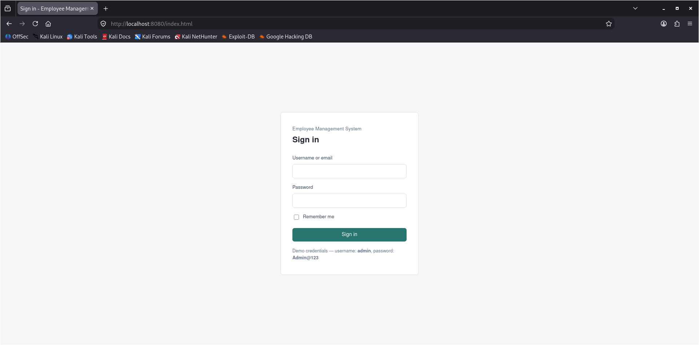
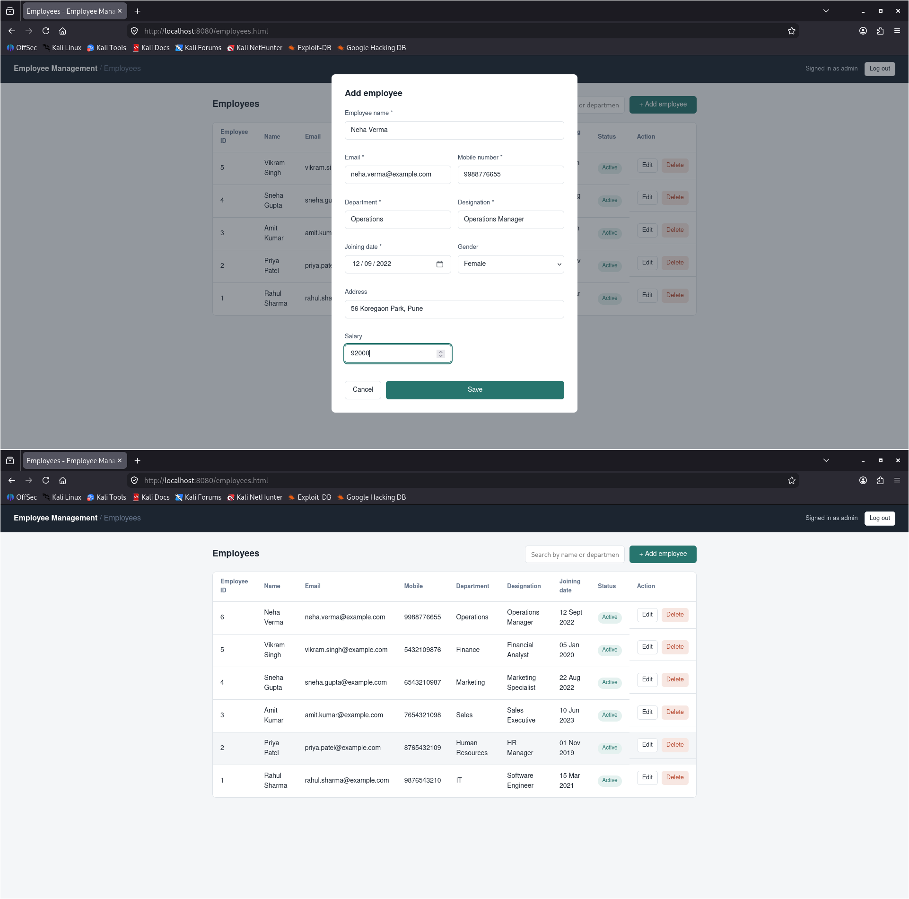
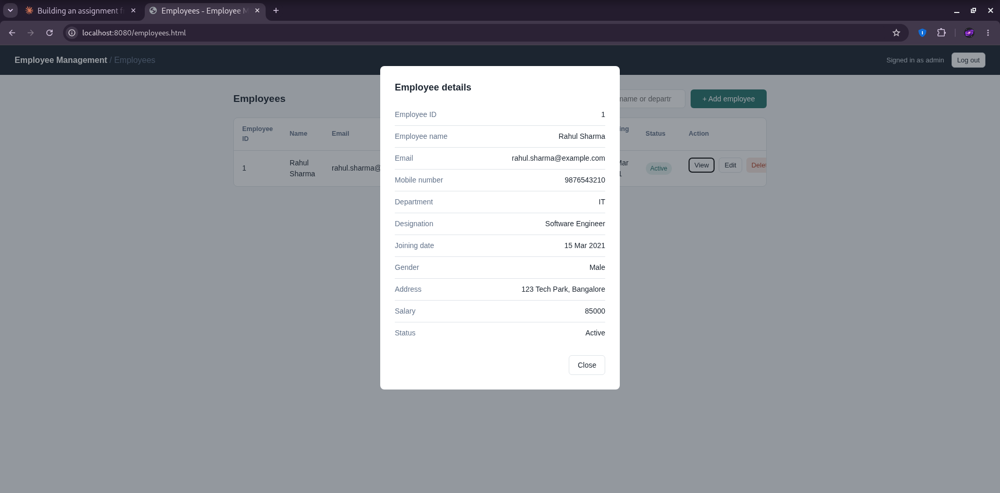
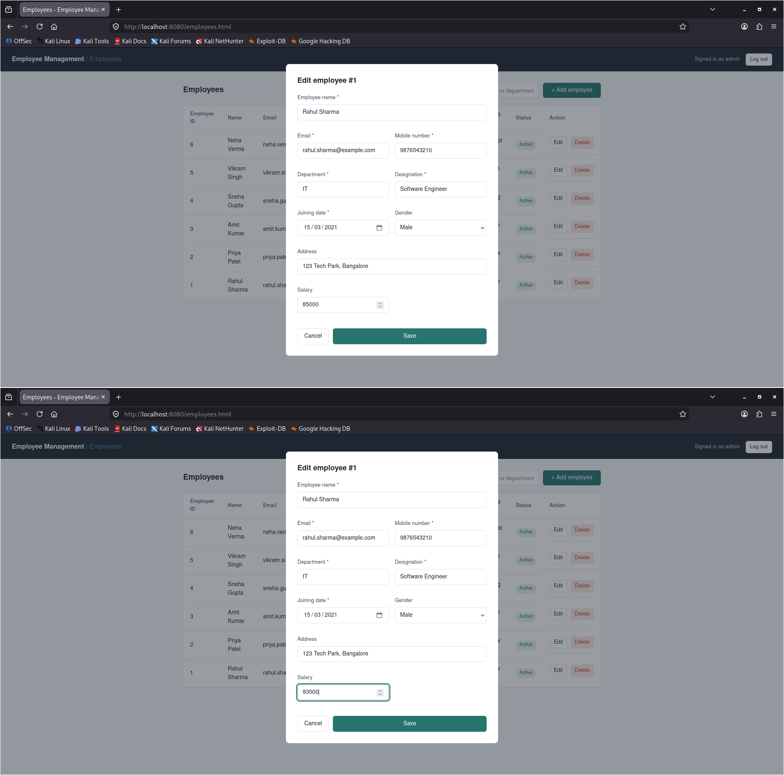
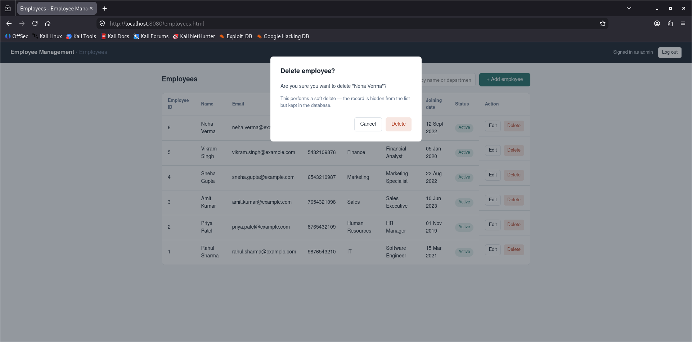

# Employee Management System
### Login Authentication and Employee Management System using CRUD Operations
**Project Submission Report**

---

## Table of Contents

1. [Project Overview](#1-project-overview)
2. [Technology Stack](#2-technology-stack)
3. [System Architecture](#3-system-architecture)
4. [Database Design](#4-database-design)
5. [API Documentation](#5-api-documentation)
6. [Application Walkthrough & Screenshots](#6-application-walkthrough--screenshots)
7. [Key Design Decisions](#7-key-design-decisions)
8. [Project Setup and Execution Steps](#8-project-setup-and-execution-steps)
9. [Deliverables Checklist](#9-deliverables-checklist)

---

## 1. Project Overview

This project implements a complete **Employee Management System** covering login authentication, employee record management, and soft-delete based data retention, built to the "Full Stack CRUD Application Development" assignment specification.

**The application allows a user to:**
- Log in using valid credentials (JWT-based authentication)
- View a list of active employees
- Add a new employee
- View a single employee's full details (read-only)
- Update an existing employee's details
- Soft-delete an employee (record retained in the database, hidden from the app)
- Log out

---

## 2. Technology Stack

| Layer | Technology Used |
|---|---|
| Frontend | HTML5, CSS3, vanilla JavaScript (fetch API) |
| Backend | Node.js, Express.js |
| Database | SQLite (via `better-sqlite3`) |
| Authentication | JSON Web Tokens (JWT) + bcrypt password hashing |
| API Testing | Postman |
| Version Control | Git |

> The assignment's suggested stack (ASP.NET Core / C# / SQL Server / Angular) was substituted with an equivalent JavaScript stack, which the assignment explicitly permits: *"Candidates may use another technology stack, provided they implement all required functionality."* An SQL Server-compatible version of the schema is included at `database/ems_sqlserver_schema.sql` for reference.

---

## 3. System Architecture

```
Browser (Frontend)
      |
      |  HTTP requests (fetch), JWT in Authorization header
      v
Express.js REST API  --->  authMiddleware (verifies JWT)
      |
      v
Controllers (authController, employeeController)
      |
      v
SQLite Database (Users, Employees tables)
```

Every request to an Employee endpoint passes through `authMiddleware`, which rejects the request with `401 Unauthorized` unless a valid JWT is attached — this is the same role ASP.NET Core's `[Authorize]` attribute plays.

**Project folder structure:**

```
PeopleDesk-Employee-Management/
├── backend/
├── frontend/
├── database/
├── postman/
├── screenshots/
└── README.md            # Main project report
```

---

## 4. Database Design

### 4.1 Users table (login credentials)

| Column | Data Type | Description |
|---|---|---|
| Id | INT (PK, auto-increment) | Unique user ID |
| Username | VARCHAR(100) | Login username |
| Email | VARCHAR(150) | User's email |
| PasswordHash | VARCHAR(MAX) | bcrypt hash — the plain password is never stored |
| IsActive | BIT | Account active flag |
| CreatedDate | DATETIME | Record creation timestamp |

### 4.2 Employees table

| Column | Data Type | Description |
|---|---|---|
| Id | INT (PK, auto-increment) | Unique employee number |
| EmployeeName | VARCHAR(150) | Full name |
| Email | VARCHAR(150) | Employee email |
| MobileNumber | VARCHAR(15) | Contact number |
| Department | VARCHAR(100) | Department |
| Designation | VARCHAR(100) | Job title |
| JoiningDate | DATE | Date of joining |
| Address | VARCHAR(255) | Optional |
| Gender | VARCHAR(10) | Optional |
| Salary | DECIMAL(12,2) | Optional |
| **IsDeleted** | BIT | **0 = Active, 1 = Deleted** (Soft Delete flag) |
| CreatedDate | DATETIME | Record creation timestamp |
| ModifiedDate | DATETIME | Last updated timestamp |

**Relationship:** `Users` and `Employees` are independent tables in this implementation — `Users` governs who can log in to the system, while `Employees` holds the records being managed. (No foreign key was required by the assignment's functional spec between the two.)

The full SQL Server script is provided separately at `database/ems_sqlserver_schema.sql`.

---

## 5. API Documentation

| # | API Name | HTTP Method | Endpoint | Auth Required | Purpose |
|---|---|---|---|---|---|
| 1 | Login | POST | `/api/auth/login` | No | Authenticates a user and returns a JWT |
| 2 | GetAllEmployees | GET | `/api/employees` | Yes | Returns all active (non-deleted) employees |
| 3 | GetEmployeeById | GET | `/api/employees/:id` | Yes | Returns one employee's full details |
| 4 | AddEmployee | POST | `/api/employees` | Yes | Creates a new employee record |
| 5 | UpdateEmployee | PUT | `/api/employees/:id` | Yes | Updates an existing employee in place |
| 6 | DeleteEmployee | DELETE | `/api/employees/:id` | Yes | Soft-deletes an employee (`IsDeleted = 1`) |

A ready-to-import Postman collection covering all six endpoints is provided at `postman/EmployeeManagementSystem.postman_collection.json`. The Login request automatically stores its JWT into a collection variable that every other request reuses.

---

## 6. Application Walkthrough & Screenshots

### 6.1 Login

The login screen validates mandatory fields, authenticates the user against the `Users` table (password compared via bcrypt, never stored or compared in plain text), and issues a JWT on success.



### 6.2 Employee List (Read — All)

After logging in, the user lands on the Employee List, which fetches and displays every **active** employee (`IsDeleted = 0`) via `GetAllEmployees`.


### 6.3 Add Employee (Create)

Clicking **"+ Add employee"** opens a form. All mandatory fields are validated both in the browser and again on the server before the record is inserted via `AddEmployee`.



### 6.4 View Employee (Read — Single)

Clicking **"View"** on any row calls `GetEmployeeById` and displays the employee's full details in a **read-only** screen — distinct from the editable form used for updates.



### 6.5 Edit Employee (Update)

Clicking **"Edit"** fetches the employee's current data via `GetEmployeeById`, pre-fills the form, and on save calls `UpdateEmployee` — which modifies the existing row in place and never inserts a new record.



### 6.6 Delete Employee (Soft Delete)

Clicking **"Delete"** prompts for confirmation before calling `DeleteEmployee`, which sets `IsDeleted = 1` on the record. The row is never physically removed from the database.



### 6.7 Employee List After Delete

Once confirmed, the deleted employee disappears from the Employee List — proving the application correctly filters out soft-deleted records from normal views, while the row itself still exists in the database.


---

## 7. Key Design Decisions

**Why JWT over server-side sessions?**
JWTs are stateless — the server doesn't need to store session data, which makes the API easier to scale horizontally. The token itself carries the signed claims (user ID, username) and is verified on every request by `authMiddleware`.

**Why Soft Delete instead of a real DELETE?**
Soft delete preserves historical/audit data and avoids issues with any other part of the system that might still reference a "deleted" record. Implemented via a single `IsDeleted` flag, checked by every read query (`WHERE IsDeleted = 0`).

**Password security:**
Passwords are hashed with bcrypt (which generates a unique salt per password automatically) before ever touching the database — the plain-text password is never stored or logged anywhere.

**A known tradeoff, worth naming honestly:** the JWT is stored in the browser's `localStorage` for simplicity in this demo, which is readable by JavaScript and therefore vulnerable to XSS in a production setting. A production system would more typically use an `httpOnly` cookie instead.

---

## 8. Project Setup and Execution Steps

**Prerequisite:** Node.js 18+ (see note on build tools below if `better-sqlite3` fails to install).

```bash
# 1. Install backend dependencies
cd backend
npm install

# 2. Create the database schema + default login user
npm run seed
#    -> username: admin   password: Admin@123

# 3. Start the API server (http://localhost:5000)
npm start

# 4. In a second terminal, serve the frontend
cd ../frontend
python3 -m http.server 8080

# 5. Open http://localhost:8080/index.html and log in
```

If `better-sqlite3` fails to install (a native module compiled during `npm install`), install build tools first: `sudo apt install -y build-essential python3`.

---

## 9. Deliverables Checklist

| # | Deliverable | Location |
|---|---|---|
| 1 | Complete Frontend Source Code | `frontend/` |
| 2 | Complete Backend Source Code | `backend/` |
| 3 | SQL Database Script | `database/ems_sqlserver_schema.sql` |
| 4 | Database Tables and Relationships | Section 4 of this report |
| 5 | API List with HTTP Methods | Section 5 of this report |
| 6 | Postman Collection | `postman/EmployeeManagementSystem.postman_collection.json` |
| 7 | Screenshots (Login, List, Add, Edit, View, Delete) | Section 6 of this report / `screenshots/` |
| 8 | Project Setup and Execution Documentation | Section 8 of this report |
| 9 | Git Repository Link | https://github.com/Harshil015/PeopleDesk-Employee-Management |
