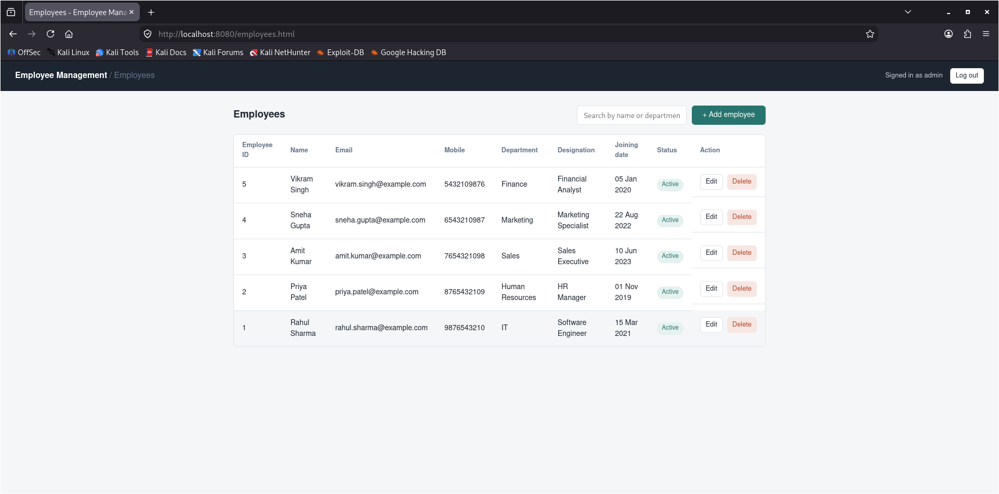

# PeopleDesk – Employee Management System

A full-stack Employee Management System with JWT-based login authentication and employee CRUD operations. The application supports viewing active employees, creating and updating employee records, viewing individual employee details, and soft-deleting records.

> **Project status:** This repository contains a working local demonstration built with Node.js, Express, SQLite, and vanilla JavaScript. The SQL Server script is provided as a schema reference; the running application currently uses SQLite.

---

## Table of contents

1. [Features](#1-features)
2. [Technology stack](#2-technology-stack)
3. [Architecture and request flow](#3-architecture-and-request-flow)
4. [Repository structure](#4-repository-structure)
5. [Database design](#5-database-design)
6. [Authentication and security](#6-authentication-and-security)
7. [API documentation](#7-api-documentation)
8. [Prerequisites](#8-prerequisites)
9. [Installation and setup](#9-installation-and-setup)
10. [SQLite database migration](#10-sqlite-database-migration)
11. [Testing the API with Postman](#11-testing-the-api-with-postman)
12. [Application screenshots](#12-application-screenshots)
13. [Design decisions](#13-design-decisions)
14. [Known limitations and future improvements](#14-known-limitations-and-future-improvements)
15. [Troubleshooting](#15-troubleshooting)

---

## 1. Features

### Authentication

- Login using username or email and password.
- Password hashes stored using bcrypt; plaintext passwords are not stored in the Users table.
- JWT issued after successful authentication.
- JWT required in the `Authorization: Bearer <token>` header for employee API endpoints.
- JWT expiry is configured for two hours.
- Login attempts are rate-limited.
- A Remember Me option selects browser storage: `sessionStorage` when unchecked and `localStorage` when checked.

### Employee management

- List all active employees.
- Search employees by name or department in the browser.
- Add a new employee.
- View employee details in a read-only modal.
- Edit an existing employee record.
- Soft-delete an employee after confirmation.
- Validate employee fields on the backend.

### Data retention

Employee deletion is implemented as a **soft delete**. The application updates `IsDeleted` to `1`; it does not physically remove the row. Normal employee queries return only rows where `IsDeleted = 0`.

---

## 2. Technology stack

| Layer | Technology | Purpose |
|---|---|---|
| Frontend | HTML5, CSS3, vanilla JavaScript | Login page and employee dashboard |
| HTTP client | Fetch API | Calls the backend REST endpoints |
| Backend | Node.js, Express.js | REST API and request handling |
| Database | SQLite | Persistent application data |
| SQLite driver | `better-sqlite3` | Parameterized SQL queries |
| Authentication | JSON Web Tokens (`jsonwebtoken`) | Authenticates protected API requests |
| Password hashing | `bcryptjs` | Hashes and verifies passwords |
| Configuration | `dotenv` | Loads backend environment variables |
| Request security | `cors`, `express-rate-limit` | Restricts cross-origin access and limits login attempts |
| API testing | Postman | Manual endpoint testing |
| Version control | Git and GitHub | Source-code management |

The assignment suggested ASP.NET Core, C#, SQL Server, and Angular. This project uses an alternative JavaScript stack. The working application uses SQLite; `database/ems_sqlserver_schema.sql` is supplied as a SQL Server schema reference and is not connected to the current Express backend.

---

## 3. Architecture and request flow

```text
Browser
  |
  | HTML / CSS / JavaScript
  | Fetch API requests
  | Authorization: Bearer <JWT>
  v
Express.js REST API (port 5000)
  |
  +--> Authentication routes --> Authentication controller
  |
  +--> Employee routes --> JWT authentication middleware
                              |
                              v
                        Employee controller
                              |
                              v
                    better-sqlite3 / SQLite
                       Users and Employees
```

### Login flow

1. The user submits credentials through `frontend/index.html`.
2. `frontend/js/login.js` calls the login method in `frontend/js/api.js`.
3. The request reaches `POST /api/auth/login`.
4. `authController.js` looks up an active user by username or email.
5. `bcryptjs` compares the submitted password with the stored password hash.
6. On success, `utils/jwt.js` signs a JWT containing the user's ID and username.
7. The frontend stores the token and redirects to `employees.html`.

### Protected employee request flow

1. The frontend makes an employee API request and attaches the JWT in the Authorization header.
2. `employeeRoutes.js` runs `requireAuth` before the employee controller.
3. `authMiddleware.js` checks the Bearer token and verifies it using `utils/jwt.js`.
4. If valid, the decoded user information is attached to `req.user` and the controller runs.
5. If missing, invalid, or expired, the API returns `401 Unauthorized`.

The frontend's page redirect is a user-experience measure only. Actual API protection is enforced by backend middleware.

---

## 4. Repository structure

```text
PeopleDesk-Employee-Management/
├── backend/
│   ├── controllers/
│   │   ├── authController.js
│   │   └── employeeController.js
│   ├── db/
│   │   ├── connection.js
│   │   ├── schema.sql
│   │   ├── seed.js
│   │   └── migrate-employees-checks.js
│   ├── middleware/
│   │   └── authMiddleware.js
│   ├── routes/
│   │   ├── authRoutes.js
│   │   └── employeeRoutes.js
│   ├── utils/
│   │   └── jwt.js
│   ├── .env.example
│   ├── package.json
│   ├── package-lock.json
│   └── server.js
├── database/
│   └── ems_sqlserver_schema.sql
├── frontend/
│   ├── css/
│   │   └── styles.css
│   ├── js/
│   │   ├── api.js
│   │   ├── config.js
│   │   ├── dashboard.js
│   │   └── login.js
│   ├── employees.html
│   └── index.html
├── postman/
│   └── EmployeeManagementSystem.postman_collection.json
├── screenshots/
│   ├── 01-login.png
│   ├── 02-employee-list.png
│   ├── 03-add-employee.png
│   ├── 04-view-employee.png
│   ├── 05-edit-employee.png
│   ├── 06-delete-confirmation.png
│   └── 07-employee-list-after-delete.png
└── README.md
```

The actual SQLite database file is created locally at `backend/db/ems.sqlite`. It is not intended to be committed to GitHub.

---

## 5. Database design

The SQLite database contains two independent tables.

### Users table

| Column | Type | Description |
|---|---|---|
| `Id` | INTEGER, primary key | Unique user identifier |
| `Username` | TEXT, unique, not null | Login username |
| `Email` | TEXT, unique, not null | Login email |
| `PasswordHash` | TEXT, not null | bcrypt password hash |
| `IsActive` | INTEGER, default `1` | Indicates whether the account is active |
| `CreatedDate` | TEXT | Account creation timestamp |

### Employees table

| Column | Type | Description |
|---|---|---|
| `Id` | INTEGER, primary key | Unique employee identifier |
| `EmployeeName` | TEXT, not null | Employee name |
| `Email` | TEXT, not null | Employee email |
| `MobileNumber` | TEXT, not null | Contact number |
| `Department` | TEXT, not null | Department |
| `Designation` | TEXT, not null | Job title |
| `JoiningDate` | TEXT, not null | Joining date (`YYYY-MM-DD`) |
| `Address` | TEXT, nullable | Optional address |
| `Gender` | TEXT, nullable | Optional gender field |
| `Salary` | REAL, nullable | Optional salary; database constraint disallows negative values |
| `IsDeleted` | INTEGER, default `0` | `0` = active, `1` = soft-deleted; constrained to these values |
| `CreatedDate` | TEXT | Creation timestamp |
| `ModifiedDate` | TEXT, nullable | Last modification timestamp |

`Users` and `Employees` are independent in this implementation. There is no foreign-key relationship between the account used to log in and the employee records.

### SQLite constraints

The current `backend/db/schema.sql` includes database-level checks for:

```sql
Salary REAL
  CHECK (Salary IS NULL OR Salary >= 0),

IsDeleted INTEGER NOT NULL DEFAULT 0
  CHECK (IsDeleted IN (0, 1))
```

The backend also validates employee input before executing insert and update statements. Database constraints provide an additional safeguard if data is written through another code path.

---

## 6. Authentication and security

### Password handling

Passwords are hashed using `bcryptjs` before they are inserted into the Users table. During login, `bcrypt.compareSync()` compares the submitted password with the stored hash. The application does not decrypt password hashes.

### JWT handling

- `backend/utils/jwt.js` reads the signing secret from `process.env.JWT_SECRET`.
- The application refuses to initialize JWT functionality if the secret is missing or shorter than 32 bytes.
- The token lifetime is two hours.
- The backend verifies the token on protected employee endpoints.

### Environment variables

The backend reads its environment configuration from `backend/.env`. A template is provided at `backend/.env.example`.

**Never commit the real `.env` file or its JWT secret.** The `.env.example` file is safe to commit because it contains variable names and example configuration only.

### Current security considerations

- `sessionStorage` and `localStorage` are accessible to JavaScript. An XSS vulnerability could expose a token stored in either location. A production deployment should consider secure `httpOnly` cookies with appropriate CSRF protection.
- Logging out removes the token from the current browser storage; it does not revoke a previously issued JWT on the server. A stolen token may remain valid until expiry unless token revocation is implemented.
- CORS restricts which browser origins can make cross-origin requests. CORS is not a replacement for authentication or authorization.
- Login requests are rate-limited. Production deployments should also configure proxy trust correctly when deployed behind a reverse proxy.
- The seed script creates a demonstration account using `admin` / `Admin@123`. Change or replace this credential before any real deployment. Do not use demonstration credentials for production accounts.

---

## 7. API documentation

Base URL for local development:

```text
http://localhost:5000/api
```

| Operation | Method | Endpoint | Authentication | Description |
|---|---|---|---|---|
| Login | POST | `/auth/login` | No | Verifies credentials and returns a JWT |
| Get all employees | GET | `/employees` | Yes | Returns active employee records |
| Get employee by ID | GET | `/employees/:id` | Yes | Returns one active employee |
| Add employee | POST | `/employees` | Yes | Creates an employee record |
| Update employee | PUT | `/employees/:id` | Yes | Updates an existing active employee |
| Delete employee | DELETE | `/employees/:id` | Yes | Soft-deletes an employee |
| Health check | GET | `/health` | No | Confirms that the API is running |

### Example login request

```http
POST /api/auth/login
Content-Type: application/json
```

```json
{
  "username": "admin",
  "password": "Admin@123"
}
```

A successful response includes a `token` and basic user information. The frontend stores the returned token and sends it with subsequent employee requests.

### Example authenticated request

```http
GET /api/employees
Authorization: Bearer <JWT>
```

### Example employee creation body

```json
{
  "employeeName": "Rahul Patel",
  "email": "rahul@example.com",
  "mobileNumber": "9876543210",
  "department": "IT",
  "designation": "Software Developer",
  "joiningDate": "2026-01-15",
  "gender": "Male",
  "address": "Ahmedabad",
  "salary": 45000
}
```

### Common response codes

| Status | Meaning |
|---|---|
| `200` | Request succeeded |
| `201` | Employee created successfully |
| `400` | Invalid input or employee ID format |
| `401` | Missing, invalid, or expired authentication token; or invalid login credentials |
| `404` | Route or active employee record not found |
| `500` | Unexpected server-side error |

All employee endpoints require a valid JWT. Employee IDs must be positive integers. The backend performs validation even if a request bypasses the frontend.

---

## 8. Prerequisites

- Node.js 18 or later and npm.
- Python 3 for serving the static frontend locally.
- Git.
- Postman (optional, for manual API testing).
- Build tools may be required if `better-sqlite3` needs to compile a native module.

On Kali Linux, install common build prerequisites with:

```bash
sudo apt update
sudo apt install -y build-essential python3
```

---

## 9. Installation and setup

### 9.1 Clone the repository

```bash
git clone https://github.com/Harshil015/PeopleDesk-Employee-Management.git
cd PeopleDesk-Employee-Management
```

If the repository remains private, your GitHub account must have permission to clone it.

### 9.2 Install backend dependencies

```bash
cd backend
npm install
```

### 9.3 Configure environment variables

Create a local environment file:

```bash
cp .env.example .env
```

Generate a strong random JWT secret:

```bash
openssl rand -base64 48
```

Open `backend/.env` and set the generated value:

```env
PORT=5000
JWT_SECRET=PASTE_YOUR_GENERATED_SECRET_HERE
FRONTEND_ORIGIN=http://localhost:8080
```

Do not copy the placeholder above literally. Replace it with the value generated on your machine. Keep `backend/.env` private and do not upload it to GitHub.

### 9.4 Create the database and demo user

From the `backend` directory:

```bash
npm run seed
```

The seed script creates the database schema if needed and creates the demonstration user if it does not already exist.

**Local demonstration credentials:**

```text
Username: admin
Password: Admin@123
```

These credentials are for local demonstration only. Change the seeding approach and credentials before a real deployment.

### 9.5 Start the backend

Still inside `backend`:

```bash
npm start
```

The API listens on:

```text
http://localhost:5000
```

Check the health endpoint in a browser or API client:

```text
http://localhost:5000/api/health
```

### 9.6 Start the frontend

Open a second terminal and run:

```bash
cd path/to/PeopleDesk-Employee-Management/frontend
python3 -m http.server 8080
```

Open the login page:

```text
http://localhost:8080/index.html
```

The frontend API URL is configured in `frontend/js/config.js`. The default points to `http://localhost:5000/api` for local development.

---

## 10. SQLite database migration

The schema file uses `CREATE TABLE IF NOT EXISTS`. This creates a table when it does not exist; it does **not** add constraints to a table that was created using an older schema.

For an existing local database created before the salary and `IsDeleted` checks were added, run the migration below. Stop the backend first so the database is not being modified during the migration.

From the `backend` directory, create a backup using SQLite's backup API:

```bash
node - <<'NODE'
const Database = require('better-sqlite3');
const db = new Database('db/ems.sqlite');

db.backup('db/ems.sqlite.backup')
  .then(() => {
    console.log('Database backup created successfully.');
    db.close();
  })
  .catch((error) => {
    console.error('Backup failed:', error.message);
    db.close();
    process.exitCode = 1;
  });
NODE
```

Then run:

```bash
node db/migrate-employees-checks.js
```

The migration checks for invalid existing salary and deletion-status values, creates a replacement Employees table with the constraints, copies the existing rows while preserving their IDs and timestamps, and replaces the old table within a transaction.

After migration, verify the table definition and database integrity:

```bash
node - <<'NODE'
const Database = require('better-sqlite3');
const db = new Database('db/ems.sqlite');

const table = db.prepare(`
  SELECT sql
  FROM sqlite_master
  WHERE type = 'table' AND name = 'Employees'
`).get();

console.log(table?.sql);
console.log(db.pragma('integrity_check'));
console.log(db.prepare('SELECT COUNT(*) AS count FROM Employees').get());

db.close();
NODE
```

Confirm that the table definition contains both CHECK constraints and that the integrity check returns `ok`.

For a new installation, the current schema creates the constraints when the Employees table is first created; an additional migration is not normally needed.

**Do not commit the database file or backup to GitHub.** Both contain local application data and are ignored by the repository's Git configuration.

---

## 11. Testing the API with Postman

Import this collection into Postman:

```text
postman/EmployeeManagementSystem.postman_collection.json
```

The collection includes requests for:

1. Login.
2. Get all employees.
3. Add employee.
4. Get employee by ID.
5. Update employee.
6. Soft-delete employee.
7. Get employee by ID after deletion (expected `404`).

The login request stores the returned JWT in a collection variable. Other employee requests reuse that token. The Add Employee request stores the newly created employee ID for subsequent requests.

Recommended manual checks:

- Login with valid credentials and confirm a `200` response.
- Login with incorrect credentials and confirm a `401` response with an error message.
- Call an employee endpoint without a token and confirm a `401` response.
- Add an employee with valid data and confirm a `201` response.
- Try invalid email, mobile number, date, and negative salary values; confirm the backend returns `400`.
- Update an existing employee and verify the same employee ID remains.
- Delete an employee and confirm it disappears from the active list.
- Request the deleted employee by ID and confirm a `404` response.
- Try a non-numeric employee ID and confirm a `400` response.

---

## 12. Application screenshots

### Login page


### Employee list


### Add employee


### View employee details


### Edit employee


### Delete confirmation


### Employee list after deletion



---

## 13. Design decisions

### Why use JWT?

JWT provides a stateless way for the API to authenticate protected requests. The backend verifies the token signature and expiry on each employee request instead of maintaining a server-side session record for this demonstration.

### Why use bcrypt?

Passwords should not be stored in plaintext. bcrypt hashes the password with a salt and provides a verification function to compare a login attempt against the stored hash.

### Why use parameterized SQL?

Database queries use prepared statements and bound parameters through `better-sqlite3`. This avoids building SQL statements by concatenating user-supplied values into SQL strings and helps prevent SQL injection.

### Why soft-delete employees?

Soft deletion retains a record while hiding it from normal application views. It can support later recovery or audit features without immediately removing the row from the database.

### Why SQLite?

SQLite is file-based and convenient for a self-contained local demonstration. The SQL Server schema reference is provided separately, but switching the running application to SQL Server would require a SQL Server driver and database integration changes.

---

## 14. Known limitations and future improvements

This is a demonstration project, not a production-ready HR platform. Possible next improvements include:

- Replace browser-accessible JWT storage with secure `httpOnly` cookies and implement CSRF protection.
- Add token revocation or another logout invalidation mechanism.
- Add role-based access control and more granular authorization.
- Add pagination and server-side search for larger employee datasets.
- Add employee audit history, including who changed a record and when.
- Add automated unit and integration tests for authentication, validation, and CRUD operations.
- Add formal database migrations for future schema changes.
- Add deployment configuration, HTTPS, structured logging, monitoring, and secret-manager integration.
- Replace the demonstration seed credentials with a secure initial-user setup process.

---

## 15. Troubleshooting

### `JWT_SECRET must be configured with at least 32 bytes`

Check that `backend/.env` exists and has a generated secret of at least 32 bytes. Confirm that `server.js` loads the file from the backend directory.

### `Cannot find module 'express-rate-limit'`

From the backend directory, run:

```bash
npm install
```

Confirm that `express-rate-limit` is listed in `backend/package.json` and `backend/package-lock.json`.

### `better-sqlite3` installation fails

Install common build dependencies and retry:

```bash
sudo apt install -y build-essential python3
npm install
```

### Frontend cannot reach the API

- Confirm the backend is running on port `5000`.
- Confirm the frontend is being served from port `8080`.
- Check `FRONTEND_ORIGIN` in `backend/.env`.
- Check `apiBaseUrl` in `frontend/js/config.js`.
- Inspect the browser console and Network tab for request or CORS errors.

### Existing database does not have the new constraints

Stop the backend, back up `backend/db/ems.sqlite`, and run `node db/migrate-employees-checks.js` from the `backend` directory. See [SQLite database migration](#10-sqlite-database-migration).

---

## Repository

[Harshil015/PeopleDesk-Employee-Management](https://github.com/Harshil015/PeopleDesk-Employee-Management)
